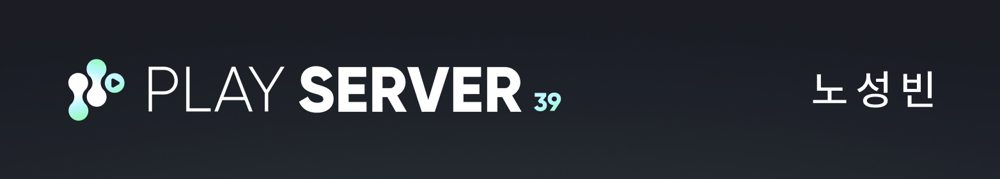
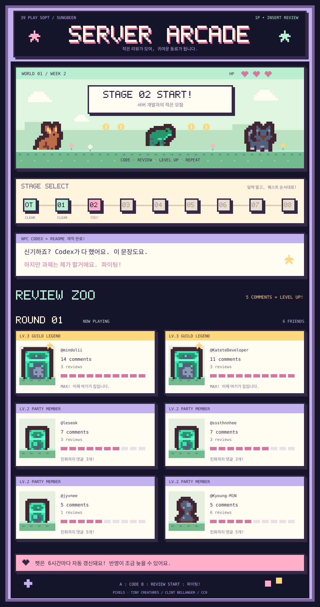

<!-- REVIEW-ZOO:START -->


**현재 퀘스트:** 2주차 · **활동 조:** Round 1  
진화 규칙: inline review comment **0–4개 LV1 · 5–9개 LV2 · 10개 이상 LV3**. 리뷰만 남겨도 LV1 동료로 합류합니다.

<details>
<summary>세이브 데이터 · 라운드별 리뷰 기록</summary>

### Round 1 · 진행 중

| 동료 | 레벨 | Inline comments | Reviews |
| --- | --- | --- | --- |
| [@mindolii](https://github.com/mindolii) | LV3 | 14 | 3 |
| [@KateteDeveloper](https://github.com/KateteDeveloper) | LV3 | 11 | 3 |
| [@leseok](https://github.com/leseok) | LV2 | 7 | 3 |
| [@sssthnnhee](https://github.com/sssthnnhee) | LV2 | 7 | 3 |
| [@jyvnee](https://github.com/jyvnee) | LV2 | 5 | 1 |
| [@Kyoung-M1N](https://github.com/Kyoung-M1N) | LV2 | 5 | 6 |

집계 데이터 확인 시각(변경 시 저장): 2026-11-13T19:52:00.868Z

</details>
<!-- REVIEW-ZOO:END -->

### 👾 BONUS STAGE · 토큰 먹는 동료

토큰 먹는 제 친구를 소개합니다!

[](https://github.com/TOKENPHAGE)

<sub>이 Mac에서 매일 오전 4시 자동 동기화 · [연동 및 관리 안내](docs/review-zoo.md#tokenphage-토큰-먹는-동료)</sub>

<details>
<summary>게임 설명서 · 제작 크레딧</summary>

리뷰를 남기면 제 README에 동료로 등록됩니다. Inline 댓글 5개마다 펫이 진화해요.
라운드가 바뀌면 새로운 파티로 출발하고, 이전 파티는 기록에 남습니다.

- **PLAYER** Sungbeen · 서버 개발 퀘스트 수행 중
- **EQUIPMENT** Codex · 프롬프트 숙련도 상승 중
- **CRAFTING** README: Codex / 과제: Human / 응원: 모두
- **PIXEL ART** [Tiny Creatures — Clint Bellanger](https://opengameart.org/content/tiny-creatures), CC0
- [세팅·자동화·집계 규칙](docs/review-zoo.md) · [리소스 라이선스](assets/review-zoo/CREDITS.md)

</details>

### 실행 및 배포 설정

로컬에서는 `application-local.example.yml`을 `application-local.yml`로 복사하고 로컬 MySQL 접속 정보를 설정합니다. 기본 프로필은 `local`입니다. JWT 키 설정과 인증 실습은 아래 [이메일 로그인과 JWT 인증](#이메일-로그인과-jwt-인증)을 참고합니다.

배포에서는 `prod` 프로필과 `SPRING_DATASOURCE_URL`, `SPRING_DATASOURCE_USERNAME`, `SPRING_DATASOURCE_PASSWORD` 환경변수를 사용합니다. GitHub Actions에서 ARM64 이미지를 빌드하고 EC2의 Docker Compose로 Spring Boot와 Nginx를 실행합니다. Actions Secrets에는 `DB_URL`, `DB_USERNAME`, `DB_PASSWORD`, `JWT_SECRET`, `DEPLOY_SSH_KEY`, `DEPLOY_KNOWN_HOSTS`가 필요하고 Variables에는 `DEPLOY_HOST`, `DEPLOY_USER`가 필요합니다. `CORS_ALLOWED_ORIGINS` 변수로 허용할 출처를 쉼표로 구분해 변경할 수 있습니다. 값을 변경한 뒤 워크플로를 수동 실행해 서버에 반영합니다.

EC2에는 Docker와 Compose가 설치되어 있어야 하며 `/home/ubuntu/assignment`의 Compose 설정과 `/home/ubuntu/.config/assignment/compose.env`를 사용합니다. 인증서는 호스트의 Certbot이 `/var/www/letsencrypt`를 통해 갱신하고 갱신 후 Nginx 컨테이너를 다시 불러옵니다. 배포 후 `GET /api/v1/health`가 응답하지 않으면 이전 이미지와 환경변수로 복구를 시도합니다. 이 경로는 애플리케이션의 HTTP 응답과 `SELECT 1`을 통한 DB 연결을 확인합니다.


### 이메일 로그인과 JWT 인증

Spring Security와 jjwt로 이메일·비밀번호 가입, 로그인, Access Token 인증을 처리합니다. 기존 도메인별 예외와 `RestResponse` 응답을 사용하고 Swagger 설명은 각 Controller의 Docs 인터페이스에서 관리합니다.

로컬 MySQL 설정 후, 실행할 터미널에서 서명 키를 준비합니다. 키는 Base64로 인코딩한 32바이트 이상이어야 합니다. 아래 명령은 실행할 때마다 새 키를 만들므로 키가 바뀌면 이전 토큰은 사용할 수 없습니다. 동일한 키를 유지하려면 생성한 값을 로컬 환경변수 또는 Git에서 제외된 `application-local.yml`의 `jwt.secret`에 보관합니다. 배포 키는 GitHub Actions의 `JWT_SECRET` Secret으로 전달합니다.

```sh
export JWT_SECRET="$(openssl rand -base64 32)"
./gradlew bootRun
```

이름은 공백이 아닌 255자 이하, 이메일은 일반적인 `local@domain.tld` 형식의 ASCII 주소로 최대 254자(local 부분은 최대 64자)를 받습니다. 이메일의 앞뒤 공백과 대소문자를 통일해 저장·조회하며 중복 가입은 409를 반환합니다. 이메일 수신함 소유 확인은 제공하지 않습니다. 비밀번호는 공백만으로 구성할 수 없으며 8자 이상, UTF-8 기준 72바이트 이하입니다. 비밀번호의 공백을 자르지 않고 BCrypt 해시만 저장하며 응답에 포함하지 않습니다.

| API | 인증 및 처리 |
| --- | --- |
| `POST /api/v1/auth/signup` | 인증 없이 이름·이메일·비밀번호로 가입, 201 |
| `POST /api/v1/auth/login` | 인증 없이 이메일·비밀번호로 로그인, 200 및 `data.accessToken` |
| `POST /api/v1/members` | 기존 회원 생성 경로 유지. 회원가입과 동일한 입력·검증 적용 |
| `GET /api/v1/members/me` | 토큰의 회원 ID와 이름 조회 |
| `DELETE /api/v1/members/{id}` | 본인만 탈퇴. 작성한 게시글이 있으면 기존처럼 409 |
| `/api/v1/posts/**` | 조회를 포함해 모든 요청에 인증 필요 |
| `GET /api/v1/health` | 인증 없이 배포 상태 확인 |
| `/swagger-ui.html`, `/swagger-ui/**`, `/v3/api-docs/**` | 인증 없이 API 문서 확인 |

가입부터 내 정보 조회까지 아래 순서로 실습합니다. Swagger에서는 로그인 응답의 `data.accessToken`을 **Authorize**에 입력하면 됩니다.

```sh
curl -X POST http://localhost:8080/api/v1/auth/signup \
  -H 'Content-Type: application/json' \
  -d '{"name":"성빈","email":"user@example.com","password":"password123"}'

curl -X POST http://localhost:8080/api/v1/auth/login \
  -H 'Content-Type: application/json' \
  -d '{"email":"user@example.com","password":"password123"}'

# 로그인 응답의 data.accessToken을 입력
curl http://localhost:8080/api/v1/members/me \
  -H 'Authorization: Bearer <accessToken>'
```

Access Token의 기본 유효 시간은 30분(`jwt.access-token-expiration`, 밀리초)입니다. 토큰 누락·위조·만료와 탈퇴한 회원의 토큰은 보호된 API에서 401을 반환합니다. 유효한 회원이라도 타인의 글 수정·삭제 또는 타인 탈퇴 요청은 403입니다. 없는 이메일과 틀린 비밀번호는 동일한 `INVALID_CREDENTIALS` 응답을 반환합니다. 세션과 Refresh Token은 사용하지 않으므로 만료 후에는 다시 로그인합니다.

게시글 작성 본문은 `{"title":"제목","content":"본문","category":"FREE"}`입니다. 작성자와 좋아요 회원은 토큰에서 결정하므로 생성 본문의 `memberId`와 좋아요 요청의 `memberId` 쿼리를 보내지 않습니다. 목록 검색의 `memberId`는 작성자 검색 조건으로 계속 사용할 수 있습니다.

기존 이름 전용 회원과 게시글·좋아요 관계를 보존하기 위해 DB의 이메일·비밀번호 컬럼은 null을 허용합니다. 신규 회원은 생성 경로에서 두 값을 반드시 검증합니다. 현재 `ddl-auto: update` 설정으로 컬럼과 이메일 고유 제약을 반영하며, 기존 회원에게 인증 정보를 자동으로 만들거나 새 가입 계정에 기존 게시글을 연결하지 않습니다. 기존 회원으로 로그인하려면 별도로 본인 확인을 거쳐 이메일과 BCrypt 해시를 등록하는 이관 절차가 필요합니다. 해당 이관 API는 제공하지 않습니다.

`./gradlew test`는 별도의 H2 테스트 DB에서 가입·로그인·토큰 오류·권한·CORS·기존 회원 보존을 검증합니다. 로컬·운영 MySQL에는 테스트 데이터를 저장하지 않습니다.
